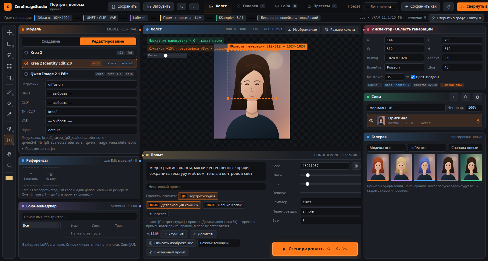
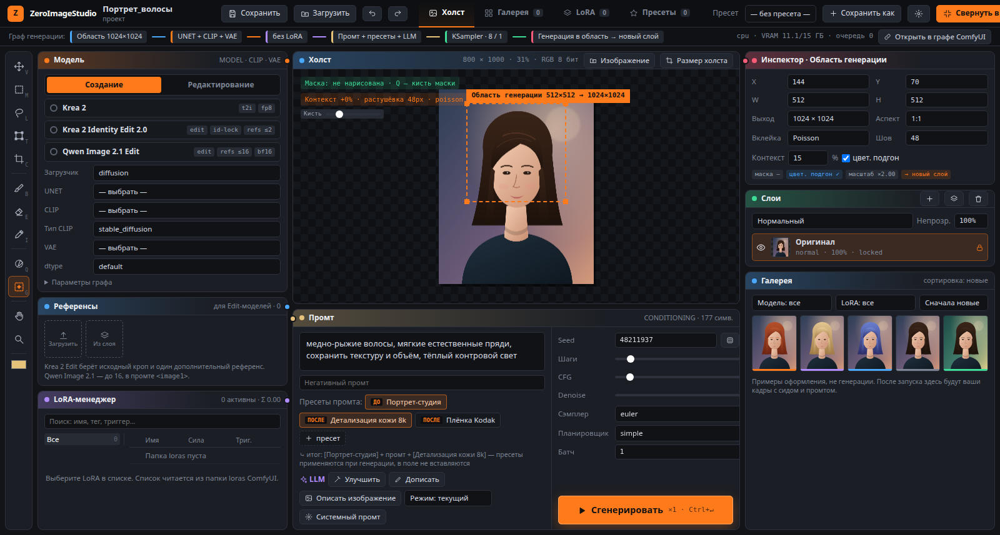
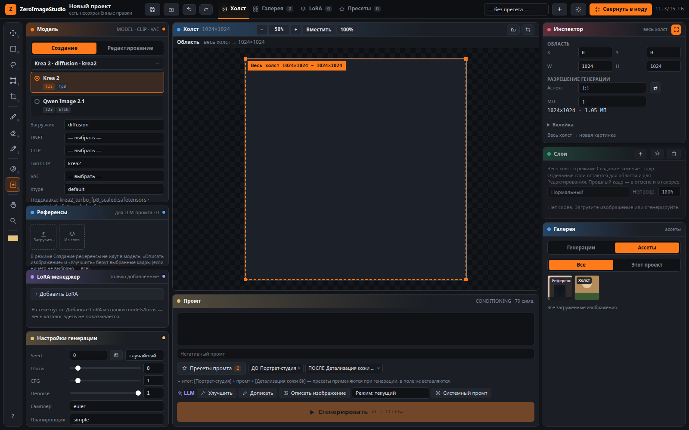
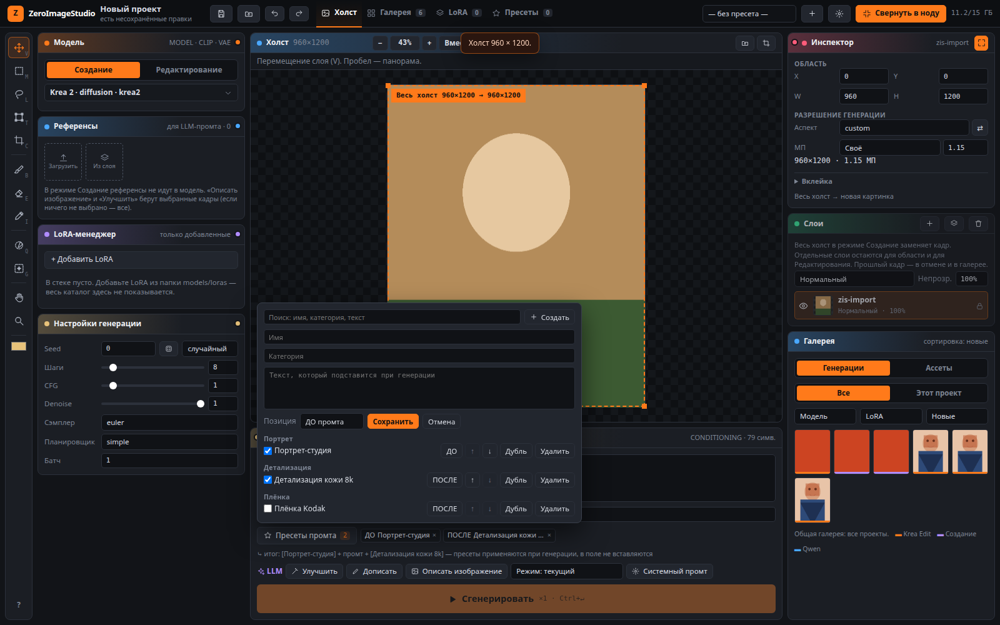
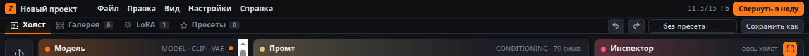
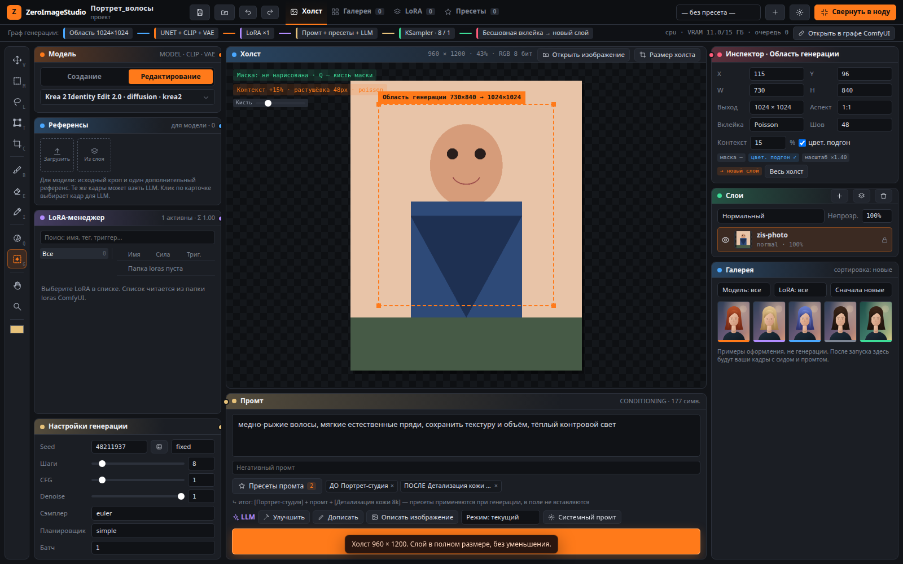
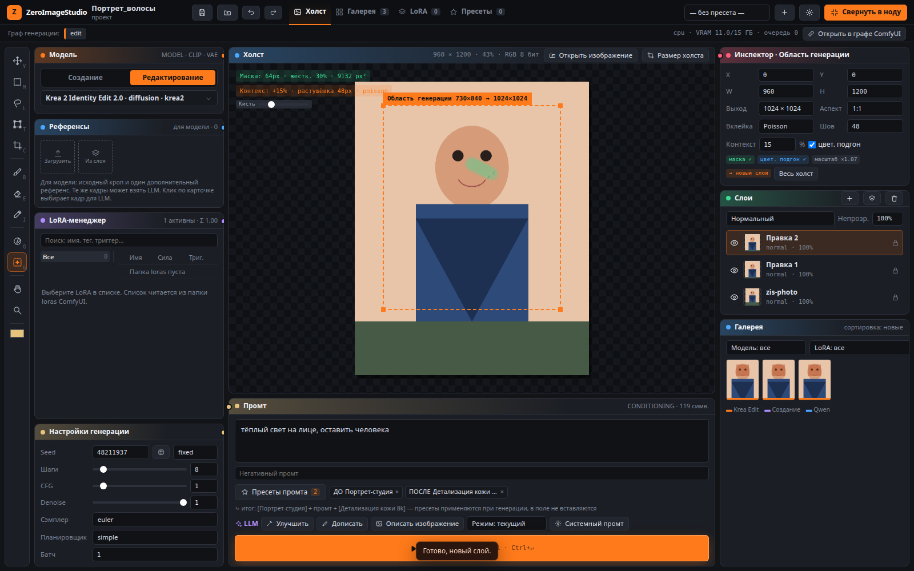

# ZeroImageStudio

ZeroImageStudio — открытая нода ComfyUI. Она разворачивает редактор на весь браузер: область на холсте, генерация или правка внутри неё, результат отдельным слоем. Свёрнутая нода отдаёт в граф сведённый кадр (`IMAGE`), маску (`MASK`) и JSON слоёв (`LAYERS`).

Два пайплайна, и ни один не привязан к одному чекпоинту:

- **Создание** — один общий граф: чекпоинт или diffusion-модель с текстовым энкодером и VAE, LoRA и сэмплер. Тот же код делает text-to-image, img2img и inpaint.
- **Редактирование** — фото на холсте, правка промтом и бесшовная вклейка на новый слой. Krea 2 Edit встроен в пакет. Qwen Image 2.1 — та же модель, что и для создания, но в этом режиме через `TextEncodeQwenImage21` и референсы.

Сторонние паки нод не нужны. Интерфейс на русском.



Пайплайн «Создание» — те же панели. Переключатель **Создание** в колонке модели.



Список моделей свёрнут по умолчанию. Строка под режимом — выбранная модель; клик раскрывает загрузчик.



Пресеты промта — кнопка с числом активных и окно поиска, а не ряд чипов.



Кнопка **Свернуть в ноду** остаётся в кадре и на узкой ширине (1280, 1440, 1920).



## Установка

Нужен ComfyUI, в котором уже есть Krea 2 и Qwen Image 2.1. Qwen Image 2.1 появился в ComfyUI 0.37; пакет проверялся на 0.42.

Корень этого репозитория и есть папка ноды. Клонирование сразу в `custom_nodes` достаточно:

```bash
cd ComfyUI/custom_nodes
git clone https://github.com/zeroleloushe/ZeroImageStudio.git
```

Перезапустите ComfyUI. В графе добавьте ноду **ZeroImageStudio — редактор изображений** и нажмите **Развернуть ZeroImageStudio**. Esc или **Свернуть в ноду** записывает кадр в выходы ноды.

Редактор открывается со страницы расширения `/extensions/ZeroImageStudio/`. Имя папки после `git clone` менять не нужно.

Нода **ZeroImageStudio — загрузчик моделей** необязательна. Редактор сам читает папки моделей ComfyUI и ставит отдельный промт в очередь. Загрузчик нужен, только если в графе должны быть сокеты `MODEL`, `CLIP` и `VAE`.

## Что нужно

Отдельных pip-зависимостей нет. Хватает того, что уже ставится с ComfyUI: `torch`, `numpy`, `Pillow`, `einops`, `aiohttp`.

Веса в репозиторий не входят. Положите файлы в обычные папки ComfyUI и выберите их в редакторе. Записи в `hints/models.json` только подсказывают типичные имена:

| Подсказка | Файлы |
| --- | --- |
| Krea 2 | `krea2_turbo_fp8_scaled.safetensors`, CLIP `qwen3vl_4b_fp8_scaled.safetensors` типа `krea2`, VAE `qwen_image_vae.safetensors` |
| Krea 2 Identity Edit 2.0 | то же плюс одна LoRA: `krea2_identity_edit_v2.safetensors` или `krea2_general_edit_v2.safetensors` |
| Qwen Image 2.1 | UNET Qwen Image 2.1, CLIP типа `qwen_image` и подходящий VAE. Одна запись и в Создании, и в Редактировании |

Ключ Civitai и OpenAI-совместимый LLM (Ollama, llama.cpp, LM Studio) необязательны. Оба пишутся в каталог пользователя ComfyUI (`user/zeroimagestudio/settings.json`), не в этот репозиторий. Пока поля пустые, кнопки сообщают, что сервис не настроен.

## Как собирается генерация

Создание и обычный inpaint используют только ноды ядра: `CheckpointLoaderSimple` либо `UNETLoader` + `CLIPLoader` + `VAELoader`, затем `LoraLoader`, `CLIPTextEncode` или `TextEncodeQwenImage21`, пустой латент или VAE-кодирование, `KSampler`, `VAEDecode`, `SaveImage`.

Способы редактирования:

| Способ | Граф |
| --- | --- |
| Inpaint / img2img | Тот же, что и Создание. С маской — `VAEEncodeForInpaint` или `InpaintModelConditioning`. Без маски кроп идёт в img2img; если denoise оставлен равным 1, подставляется 0.75. |
| Krea 2 Edit | `ZeroImageStudioKrea2EditModelPatch` и `ZeroImageStudioKrea2EditGroundedEncode`. |
| Qwen Image 2.1 | Ядро: `TextEncodeQwenImage21`, слоты `images.image_1` … `images.image_16`. |
| Прежний Qwen Image Edit | Ядро: `TextEncodeQwenImageEdit`. Это не 2.1. |

Вклейка на NumPy: растушёвка, жёсткая маска или Пуассон (Якоби по пирамиде) и по желанию подгон цвета по рамке маски (Reinhard). Исходный слой остаётся снизу.

## Krea 2 Edit

Прямой проход правки взят из [lbouaraba/comfyui-krea2edit](https://github.com/lbouaraba/comfyui-krea2edit) v2.0.0 (коммит `13ef60f`, Apache-2.0). Подробности — в [README автора](https://github.com/lbouaraba/comfyui-krea2edit/blob/v2.0.0/README.md), примере [workflow](https://github.com/lbouaraba/comfyui-krea2edit/blob/v2.0.0/workflows/krea2_identity_edit.json) и в `NOTICE`.

Что делают две ноды:

1. **Патч модели.** VAE-латент исходника и одного необязательного второго референса ставится в `SingleStreamDiT` как кадры RoPE 1 и 2. Режим `fit` пересчитывает картинку в пикселях на сетку выхода. Подключите VAE, исходное изображение и тот же латент, что идёт в сэмплер, чтобы кодирование прошло до сэмплинга.
2. **Grounded encode.** Инструкция токенизируется вместе с картинкой шаблоном Qwen3-VL (`<|vision_start|><|image_pad|><|vision_end|>` и текст). При CFG выше 1 негатив тоже заземляется на ту же картинку с пустым промтом. `grounding_px` ограничивает длинную сторону для визуального энкодера (по умолчанию 768; для лиц часто ставят 1024).

Нужны обе ноды. Обычный `CLIPTextEncode` не совпадает с тем, как учили LoRA.

В примере workflow у автора: 1024×1024, euler / simple, CFG 1, 10 шагов, grounding 768. В его README быстрый путь Turbo — около 8 шагов при CFG 1, а для удаления объекта — модель Raw, CFG около 3 и порядка 20 шагов. В этом редакторе denoise для Krea принудительно 1: локальность даёт маска. Уходит один дополнительный референс, остальные отбрасываются.

В **Параметрах графа** тот же пайплайн можно направить на установленный пакет `comfyui-krea2edit` вместо встроенных нод.

## Qwen Image 2.1

`TextEncodeQwenImage21` отдаёт латент по первому референсу. Сэмплировать другой размер нельзя: правка съезжает. При `resolution` 1024 и подключённом VAE у ComfyUI известен шум на референсах ([issue #16435](https://github.com/Comfy-Org/ComfyUI/issues/16435)). Редактор предупреждает и предлагает 992 или 1056. В промте картинки называются `<image1>`, `<image2>` и далее. Референсов передаётся до 16.

## Как править фото

1. Загрузите снимок: **Открыть изображение**, перетаскивание на холст или Ctrl+V. Если у ноды в графе подключён вход `IMAGE` (обычно Load Image с выбранным файлом), то же окно открывается при развороте редактора.
2. Диалог предлагает подогнать холст под полный размер кадра. Пиксели не уменьшаются.
3. Область по умолчанию — весь холст, он масштабируется до выходного размера модели. Свою область ставят инструментом G или кнопкой в инспекторе. Маска (Q) необязательна и ограничивает вклейку.
4. Напишите промт правки и нажмите **Сгенерировать**. Результат бесшовно ложится на новый слой «Правка N» поверх исходника. Исходный слой не меняется. Каждая следующая правка добавляет свой слой.



Область и маска поверх загруженного кадра.


Две правки подряд: «Правка 2» и «Правка 1» лежат над исходным слоем, его пиксели не меняются.



## Редактор

- Холст открывается пустым: «Откройте изображение, перетащите или вставьте Ctrl+V» и пресеты **Новый холст**. Демо-портрет и примеры галереи только с `?demo=1`.
- Масштаб вмещается в окно при загрузке, смене размера окна и холста. В шапке холста: вместить, 100%, плюс и минус, процент. Колёсико крутит вокруг курсора, пробел двигает кадр, Ctrl+0 вмещает, Ctrl+1 — 100%.
- Параметры инструмента (кисть, маска, область) стоят полосой под шапкой холста, не поверх картинки.
- Перемещение, рамка, лассо, масштаб, кадрирование, кисть, ластик, пипетка, маска, область генерации, рука, зум. Буквы инструментов — в подсказках, шпаргалка на `?`. `[` и `]` меняют размер кисти. Ctrl+S сохраняет, Ctrl+Z и Ctrl+Shift+Z — отмена и повтор, в том числе слоёв и генераций.
- Сид по умолчанию случайный: каждый запуск берёт новый, он пишется в метаданные слоя и галереи. Кубик ставит новый сид, режимы «фиксированный» и «+1» рядом.
- **Сгенерировать** не нажимается, пока нет промта, файлов модели или (в правке) картинки. Подсказка называет причину. Если запуск всё же упирается в пустой загрузчик, тост пишет, какого файла нет, и открывает список моделей.
- Пока идёт счёт, на области видны шаг и превью, кнопка становится **Отмена**.
- Несохранённый проект предупреждает при сворачивании и при закрытии вкладки. Автосохранение — раз в 3 минуты в `user/zeroimagestudio`.
- Список моделей зависит от режима. В **Создании** — Krea 2 и Qwen Image 2.1. В **Редактировании** — Krea 2 Identity Edit 2.0 и Qwen Image 2.1. У каждой подсказки в `hints/models.json` есть `pipelines`. Переключение режима помнит выбранную модель отдельно.
- Референсы видны в обоих режимах. В Создании они не попадают в граф диффузии и служат только картинками для LLM («Описать изображение», «Улучшить»). В Редактировании они идут в модель (Krea 2 — исходный кроп и один дополнительный кадр; Qwen Image 2.1 — до 16, в промте `<image1>`…) и тоже доступны LLM. Клик по карточке выбирает кадр для LLM.
- Пресеты промта открываются кнопкой **Пресеты промта**: поиск, категории, включение, ДО/ПОСЛЕ, порядок. Они хранятся в `user/zeroimagestudio/prompt_presets.json`.
- Прямоугольник области задаёт выходной размер, аспект, запас контекста и способ вклейки.
- У слоёв есть видимость, замок, непрозрачность, режим наложения, дубль, удаление и перетаскивание порядка. Отмена и повтор хранят 20 шагов.
- Референс берётся из файла или с активного слоя. Заголовок панели говорит, для кого кадр: «для LLM-промта» или «для модели».
- Галерея пишет PNG в `output/zeroimagestudio/gallery` с промтом, сидом, моделью и LoRA. Это общая папка всех проектов: переключатель **Все генерации** / **Этот проект** фильтрует кадры (старые записи без проекта видны только в общем списке). **Применить заново** подставляет настройки и не запускает задачу.
- **Сохранить** кладёт проект в `user/zeroimagestudio/projects` и скачивает zip.
- Пресет генерации хранит модель, LoRA, сэмплер и область, но не пиксели холста. Пресеты промта оборачивают текст только в момент постановки в очередь.
- Список LoRA — дерево `models/loras`. **Civitai info** считает хеш файла и читает публичный API версии модели. Триггеры можно вставить в начало, в конец или не вставлять.
- Кнопки LLM зовут OpenAI-совместимый `/chat/completions`: улучшить, дописать или описать холст. «Описать изображение» и «Улучшить» прикладывают выбранные референсы (если ни один не выбран — все, до трёх) как картинки. «Описать» ещё и сведённый холст.

Каждый запуск — обычный `/prompt` ComfyUI. Повторное нажатие во время счёта вызывает `/interrupt`.

## Своя модель

Добавьте объект в `hints/models.json`. Поле `pipelines` — список режимов, где модель видна: `create`, `edit` или оба. `tags` может быть объектом с ключами режимов. Для правки `edit_method`: `inpaint`, `krea2_edit`, `qwen_image_21` или `qwen_image`. В `defaults` — имена файлов. `sampler` и `output` необязательны. Сборщики графа из-за этого менять не нужно.

## Разработка

```bash
python -m unittest discover -s tests
```

Тесты проверяют сборку промта, API-графы обоих пайплайнов и вклейку. Torch и запущенный ComfyUI не нужны.

## Как помочь

Issues и pull request принимаются.

- Пайплайны остаются общими. Новая модель — это подсказка и пресет, а не новый код, если для неё не нужна нода, которой нет в ядре ComfyUI.
- Не добавляйте зависимость от другого пака нод. Если код включается в репозиторий, сохраните его лицензию и допишите атрибуцию в `NOTICE`.
- Строки интерфейса — на русском.
- Не коммитьте ключи API, веса моделей и локальные пути машины. Настройки живут в каталоге пользователя ComfyUI.

## Лицензия

Apache License 2.0. Текст — в [LICENSE](LICENSE), атрибуция — в [NOTICE](NOTICE).

`zeroimagestudio_krea2edit.py` происходит из comfyui-krea2edit v2.0.0, тоже Apache-2.0. Веса Krea Edit в этот репозиторий не входят и остаются под своей лицензией.
